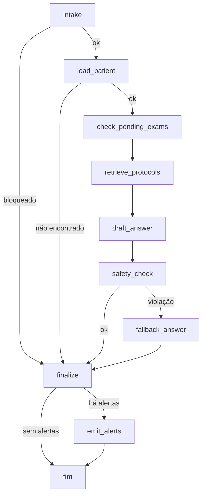

# Relatório técnico — Assistente médico virtual (Tech Challenge Fase 3)

**Curso:** FIAP PosTech — IA para Devs · **Grupo:** _preencher nomes_ · **Repositório:** https://github.com/nsouzajrs/desafio-tecnico-fase3

> Como usar este arquivo: as seções 1, 2, 4, 5 e 7 já descrevem o que foi implementado. Os trechos marcados com **PREENCHER**
> dependem de resultados que só existem depois de rodar o treino e a avaliação no Colab. Apague estas instruções e os marcadores ao finalizar.

---

## 1. Introdução e objetivo

Na Fase 3, o desafio é evoluir a solução de apoio clínico para um **assistente virtual** que (a) usa um LLM ajustado (*fine-tuning*) com dados do hospital,
(b) consulta dados estruturados de pacientes por meio do LangChain, (c) orquestra fluxos clínicos automatizados com LangGraph e (d) opera com
segurança: limites de atuação, auditoria e explicabilidade.

Como dados reais de hospital são sigilosos (LGPD), o projeto usa um **hospital fictício** ("Hospital Modelo") com protocolos, pacientes e documentos sintéticos,
somados ao PubMedQA para conhecimento biomédico. O assistente é de **apoio à decisão**: nunca prescreve, e toda saída exige validação humana.

## 2. Dados

### 2.1 Fontes

| Fonte | Descrição | Uso |
|---|---|---|
| PubMedQA (`ori_pqal.json`) | 1000 perguntas biomédicas em inglês rotuladas por especialistas (yes/no/maybe) · licença MIT | treino, validação e teste |
| Hospital sintético | 11 protocolos, 6 pacientes, FAQs, modelos de laudo/receita, recusas e perguntas sem base (português) | treino, validação e teste |

### 2.2 Tamanhos (de `data/processed/stats.json`)

| Conjunto | Total | PubMedQA | Hospital |
|---|---|---|---|
| Treino | 725 | 500 | 225 |
| Validação | 64 | 40 | 24 |
| Teste | 232 | 200 | 32 |

Distribuição de `yes/no/maybe` no treino do PubMedQA: yes 55,4% · no 33,8% · maybe 10,8% (teste: 56,5% / 34,0% / 9,5%).
Parte dos protocolos (`HOLDOUT_PROTOCOLS`) aparece **apenas no teste**, para medir generalização.

### 2.3 Anonimização

Regras (regex) que substituem CPF, telefone, e-mail, datas, CRM, número de prontuário e nomes após títulos por marcadores (`[CPF]`, `[NOME]`...).
Aplicada a todo conteúdo de origem hospitalar e também a qualquer texto livre antes de gravá-lo no log de auditoria.
Demonstração com texto fictício: `scripts/demo_anonymization.py` (10 substituições em um parágrafo de exemplo).

Os dados sintéticos já são gerados sem dados pessoais; por isso o contador do `stats.json` é zero. A etapa existe para que o pipeline seja idêntico ao que seria usado com dados reais.
**Limitação:** nomes só são detectados após títulos; em produção seriam necessários NER em português, revisão por amostragem e validação jurídica.

### 2.4 Curadoria

- remoção de exemplos duplicados e de respostas vazias;
- as respostas-alvo do hospital precisam passar nos **mesmos guardrails** usados em produção (sem dose, sem linguagem prescritiva, com fonte válida e lembrete de validação);
- exemplos acima de 1536 tokens são descartados (não cortados).

> **PREENCHER:** quantos exemplos foram descartados por curadoria e por tamanho (a saída do `build_dataset` e a linha "descartados" do treino mostram).

## 3. Fine-tuning

### 3.1 Modelo e técnica

Llama 3.2 3B Instruct, com **QLoRA**: modelo base congelado e quantizado em 4 bits (NF4, dupla quantização) e treino de matrizes LoRA nas projeções
`q, k, v, o, gate, up, down` (~1% dos parâmetros). Escolhido para caber na GPU T4 (16 GB) do Colab gratuito.

| Hiperparâmetro | Valor |
|---|---|
| LoRA | r=16, alpha=32, dropout=0,05 |
| Batch | 1 por dispositivo × 8 de acumulação = 8 efetivo |
| Taxa de aprendizado | 2e-4, agendador cosseno, warmup 5% |
| Épocas | 2 |
| Precisão | fp16 (a T4 não tem bf16 nativo) |
| Otimizador | `paged_adamw_8bit` |
| Comprimento máximo | 1536 tokens |
| Checkpoints | a cada 25 passos, no Google Drive, com retomada automática |

A **máscara de prompt** faz a loss considerar só os tokens da resposta.

### 3.2 Execução

> **PREENCHER:** GPU usada, tempo total de treino, número de passos, quantas vezes a sessão caiu e foi retomada,
> loss final de treino e de validação. Inclua a curva (gráfico do notebook 02) e o conteúdo relevante de `training_summary.json`.

## 4. Assistente (LangChain + LangGraph)

### 4.1 Componentes

| Componente | Papel |
|---|---|
| `retrieval.py` | recupera trechos de protocolos por similaridade TF-IDF (RAG) |
| `tools.py` | ferramentas LangChain: `get_patient_record`, `list_exams`, `search_protocols` |
| `database.py` | SQLite com prontuários sintéticos (queixa, condições, sinais vitais, exames) |
| `chains.py` | pipeline LCEL: prompt (paciente + trechos + pergunta) → LLM → texto |
| `llm.py` | backends intercambiáveis: `hf` (Llama + adapter), `ollama`, `fake` (testes) |
| `graph.py` | fluxo clínico em LangGraph |

O prompt do assistente é **o mesmo usado no treino**, o que evita descompasso entre treino e uso.

### 4.2 Fluxo (LangGraph)

Versão gerada automaticamente pelo LangGraph: `docs/diagrama_fluxo.mmd`.

| Nó | O que faz |
|---|---|
| `intake` | valida a pergunta (bloqueia *prompt injection*; sinaliza pedidos de prescrição) |
| `load_patient` | consulta o prontuário; encerra se o paciente não existir |
| `check_pending_exams` | lista exames, marca atrasados e resultados críticos e gera alertas |
| `retrieve_protocols` | recupera trechos de protocolo; inclui regras de prescrição/exames quando relevantes |
| `draft_answer` | a LLM gera o rascunho com fontes `[ID#seção]` |
| `safety_check` | aplica os guardrails de saída |
| `fallback_answer` | resposta determinística baseada nos protocolos, se o rascunho for reprovado |
| `finalize` | define o status `PENDENTE_VALIDACAO_HUMANA`, monta a explicação e registra no log |
| `emit_alerts` | registra os alertas para a equipe médica |

## 5. Segurança, validação e explicabilidade

- **Limites de atuação:** o assistente nunca prescreve. Saídas com dose (ex.: "500 mg") ou verbos prescritivos ("administre") são reprovadas.
- **Fonte obrigatória:** toda resposta precisa citar `[ID#seção]` de trechos que realmente estavam no contexto; citações inventadas reprovam a resposta.
- **Validação humana:** o status final é sempre `PENDENTE_VALIDACAO_HUMANA`; a decisão do médico (aprovado/rejeitado) é registrada.
- **Auditoria:** log em JSON Lines (`logs/audit.jsonl`) com `request_id`, pergunta, paciente, exames, fontes, rascunho, resultado dos guardrails, alertas e decisão humana. Texto livre é anonimizado antes de gravar.
- **Explicabilidade:** cada resposta traz as fontes citadas com o trecho original e os campos do prontuário usados.
- **Regras determinísticas (regex):** auditáveis e independentes da LLM.

> **PREENCHER:** exemplos reais (trechos do `audit.jsonl` e a explicação de uma resposta) obtidos na demonstração com o modelo fine-tuned.

## 6. Avaliação

### 6.1 Metodologia

Mesmo conjunto de teste e mesmos prompts para o **modelo base** e o **fine-tuned**, com decodificação gulosa (sem aleatoriedade). Amostra: até 100 exemplos do PubMedQA e 100 do hospital (o teste do hospital tem 32).

| Grupo | Métricas |
|---|---|
| PubMedQA | acerto de `yes/no/maybe` (`decision_correct`), respostas sem decisão (`decision_missing`), ROUGE-L |
| Hospital | `citation_recall`, `citation_precision`, `hallucinated_citation`, `dose` (deve ser 0), `disclaimer`, `refusal`, `no_base` |

### 6.2 Resultados

> **PREENCHER** com `reports/*.json` (notebook 03):
>
> | Métrica | Base | Fine-tuned |
> |---|---|---|
> | PubMedQA — acerto yes/no/maybe | | |
> | PubMedQA — sem decisão | | |
> | Hospital — recall de citação | | |
> | Hospital — citação inventada | | |
> | Hospital — gerou dose | | |
> | Hospital — recusou prescrição | | |
> | Hospital — admitiu falta de base | | |

### 6.3 Análise

> **PREENCHER:** o que melhorou e o que não melhorou. Pontos para discutir: o ganho é maior em **comportamento** (formato, citação, recusa)
> do que em conhecimento? A amostra de teste do hospital é pequena (32), então diferenças pequenas não são conclusivas. Inclua 2–3 exemplos qualitativos
> (o notebook 03 tem a seção de análise das respostas).

## 7. Limitações e riscos

- Dados do hospital sintéticos e em pequena quantidade; o fine-tuning ensina comportamento, não medicina.
- Protocolos fictícios e didáticos, sem doses: não representam diretrizes clínicas reais.
- Anonimização por regras (sem NER); nomes soltos no texto podem passar.
- Recuperação TF-IDF: limitada a correspondência lexical; embeddings seriam uma evolução.
- Modelo de 3B parâmetros: pode errar ou ser incoerente; por isso a validação humana e os guardrails são obrigatórios.
- Em uso real seriam necessários: validação clínica, avaliação de viés, conformidade com a LGPD e com normas do CFM, e monitoramento contínuo.

## 8. Conclusão

> **PREENCHER** após a avaliação: o que o grupo aprendeu, o que funcionou, próximos passos (mais dados, embeddings, avaliação com especialistas, API/interface).

## 9. Referências

- Jin, Q. et al. *PubMedQA: A Dataset for Biomedical Research Question Answering.* EMNLP-IJCNLP 2019. <https://github.com/pubmedqa/pubmedqa>
- Dettmers, T. et al. *QLoRA: Efficient Finetuning of Quantized LLMs.* 2023.
- Hu, E. et al. *LoRA: Low-Rank Adaptation of Large Language Models.* 2021.
- Documentação do LangChain, LangGraph, Hugging Face Transformers e PEFT.
