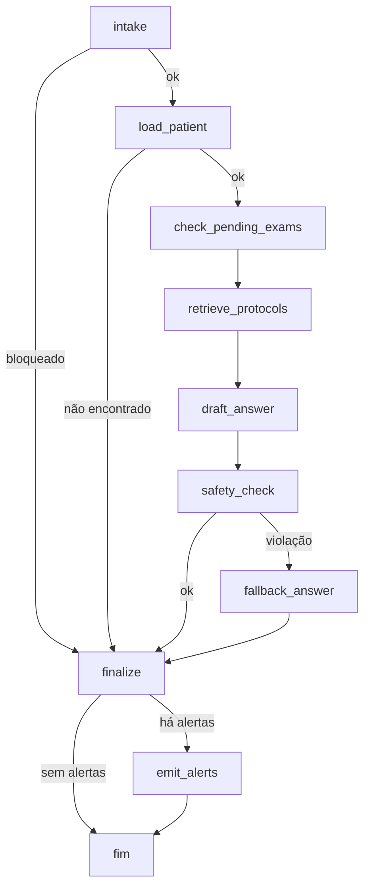

# Relatório técnico — Assistente médico virtual (Tech Challenge Fase 3)

**Curso:** FIAP PosTech — IA para Devs · **Grupo:** _preencher nomes_ · **Repositório:** https://github.com/nsouzajrs/desafio-tecnico-fase3

> Estado: seções 3.2, 6 e 8 preenchidas com os resultados da execução `run1_3b` (arquivos em `reports/`).
> Ainda marcados com **PREENCHER**: nomes do grupo, exemplos do log de auditoria do assistente com o modelo fine-tuned (seção 5) e a conclusão do grupo.

---

## 1. Introdução e objetivo

Na Fase 3, o desafio é evoluir a solução de apoio clínico para um **assistente virtual** que (a) usa um LLM ajustado (*fine-tuning*) com dados do hospital,
(b) consulta dados estruturados de pacientes por meio do LangChain, (c) orquestra fluxos clínicos automatizados com LangGraph e (d) opera com
segurança: limites de atuação, auditoria e explicabilidade.

Como dados reais de hospital são sigilosos (LGPD), o projeto usa um **hospital fictício** ("Hospital Modelo") com protocolos, pacientes e documentos sintéticos,
somados ao PubMedQA para conhecimento biomédico. O assistente é de **apoio à decisão**: nunca prescreve, e toda saída exige validação humana.

## 2. Dados

### 2.1 Fontes

| Fonte | Descrição | Uso |
|---|---|---|
| PubMedQA (`ori_pqal.json`) | 1000 perguntas biomédicas em inglês rotuladas por especialistas (yes/no/maybe) · licença MIT | treino, validação e teste |
| Hospital sintético | 11 protocolos, 6 pacientes, FAQs, modelos de laudo/receita, recusas e perguntas sem base (português) | treino, validação e teste |

### 2.2 Tamanhos (de `data/processed/stats.json`)

| Conjunto | Total | PubMedQA | Hospital |
|---|---|---|---|
| Treino | 725 | 500 | 225 |
| Validação | 64 | 40 | 24 |
| Teste | 232 | 200 | 32 |

Distribuição de `yes/no/maybe` no treino do PubMedQA: yes 55,4% · no 33,8% · maybe 10,8% (teste: 56,5% / 34,0% / 9,5%).
Parte dos protocolos (`HOLDOUT_PROTOCOLS`) aparece **apenas no teste**, para medir generalização.

### 2.3 Anonimização

Regras (regex) que substituem CPF, telefone, e-mail, datas, CRM, número de prontuário e nomes após títulos por marcadores (`[CPF]`, `[NOME]`...).
Aplicada a todo conteúdo de origem hospitalar e também a qualquer texto livre antes de gravá-lo no log de auditoria.
Demonstração com texto fictício: `scripts/demo_anonymization.py` (10 substituições em um parágrafo de exemplo).

Os dados sintéticos já são gerados sem dados pessoais; por isso o contador do `stats.json` é zero. A etapa existe para que o pipeline seja idêntico ao que seria usado com dados reais.
**Limitação:** nomes só são detectados após títulos; em produção seriam necessários NER em português, revisão por amostragem e validação jurídica.

### 2.4 Curadoria

- remoção de exemplos duplicados e de respostas vazias;
- as respostas-alvo do hospital precisam passar nos **mesmos guardrails** usados em produção (sem dose, sem linguagem prescritiva, com fonte válida e lembrete de validação);
- exemplos acima de 1536 tokens são descartados (não cortados).

No treino real: **0 exemplos descartados por tamanho** (> 1536 tokens) no treino e 0 na validação. O `stats.json` não registra remoções por duplicidade ou resposta vazia (`curation` vazio).

## 3. Fine-tuning

### 3.1 Modelo e técnica

Llama 3.2 3B Instruct, com **QLoRA**: modelo base congelado e quantizado em 4 bits (NF4, dupla quantização) e treino de matrizes LoRA nas projeções
`q, k, v, o, gate, up, down` (~1% dos parâmetros). Escolhido para caber na GPU T4 (16 GB) do Colab gratuito.

| Hiperparâmetro | Valor |
|---|---|
| LoRA | r=16, alpha=32, dropout=0,05 |
| Batch | 1 por dispositivo × 8 de acumulação = 8 efetivo |
| Taxa de aprendizado | 2e-4, agendador cosseno, warmup 5% |
| Épocas | 2 |
| Precisão | fp16 (a T4 não tem bf16 nativo) |
| Otimizador | `paged_adamw_8bit` |
| Comprimento máximo | 1536 tokens |
| Checkpoints | a cada 25 passos (últimos 2 mantidos), com retomada automática. Planejado para o Google Drive; **nesta execução o Drive não pôde ser montado** (erro `credential propagation was unsuccessful`) e os checkpoints ficaram no disco local do Colab |

A **máscara de prompt** faz a loss considerar só os tokens da resposta.

### 3.2 Execução

Execução `run1_3b` no Google Colab (gratuito), GPU **Tesla T4** (15 GB), Llama 3.2 3B Instruct.

| Item | Valor |
|---|---|
| Exemplos de treino / validação | 725 / 64 (0 descartados por tamanho) |
| Parâmetros treináveis | 24.313.856 de 3.237.063.680 (0,75%) |
| Passos | 182 (2 épocas, batch efetivo 8) |
| Tempo de treino | 2.287 s (**38 min 7 s**), ~12,6 s por passo, já incluindo 3 validações de ~32 s |
| Quedas de sessão / retomadas | 0 (o mecanismo de retomada não foi exercitado nesta execução) |
| Loss de treino (média) | 0,941 (de ~1,6 no início para ~0,7 a 0,9 no fim) |
| Loss de validação | passo 50: 1,112 · passo 100: **1,110** · passo 150: 1,131 |

A validação estabilizou cedo (por volta do passo 50) e subiu levemente no passo 150, enquanto a loss de treino continuou caindo:
sinal de **início de overfitting** na segunda época. A diferença é pequena e a validação tem só 64 exemplos, então não é conclusivo.
O adapter avaliado é o do **último passo (182)**; não há `load_best_model_at_end` e o passo 182 não teve validação própria.
No smoke test, o passo 1 teve `grad_norm = nan` (provável estouro do fp16, com o passo pulado pelo *loss scaling*); não se repetiu no treino completo.
O `max_grad_norm` configurado é 0,3, então os passos com `grad_norm` maior que isso foram cortados.

Curva de aprendizado: `learning_curve.png` (gerada pelo notebook 02).

## 4. Assistente (LangChain + LangGraph)

### 4.1 Componentes

| Componente | Papel |
|---|---|
| `retrieval.py` | recupera trechos de protocolos por similaridade TF-IDF (RAG) |
| `tools.py` | ferramentas LangChain: `get_patient_record`, `list_exams`, `search_protocols` |
| `database.py` | SQLite com prontuários sintéticos (queixa, condições, sinais vitais, exames) |
| `chains.py` | pipeline LCEL: prompt (paciente + trechos + pergunta) → LLM → texto |
| `llm.py` | backends intercambiáveis: `hf` (Llama + adapter), `ollama`, `fake` (testes) |
| `graph.py` | fluxo clínico em LangGraph |

O prompt do assistente é **o mesmo usado no treino**, o que evita descompasso entre treino e uso.

### 4.2 Fluxo (LangGraph)

Versão gerada automaticamente pelo LangGraph: `docs/diagrama_fluxo.mmd`.

| Nó | O que faz |
|---|---|
| `intake` | valida a pergunta (bloqueia *prompt injection*; sinaliza pedidos de prescrição) |
| `load_patient` | consulta o prontuário; encerra se o paciente não existir |
| `check_pending_exams` | lista exames, marca atrasados e resultados críticos e gera alertas |
| `retrieve_protocols` | recupera trechos de protocolo; inclui regras de prescrição/exames quando relevantes |
| `draft_answer` | a LLM gera o rascunho com fontes `[ID#seção]` |
| `safety_check` | aplica os guardrails de saída |
| `fallback_answer` | resposta determinística baseada nos protocolos, se o rascunho for reprovado |
| `finalize` | define o status `PENDENTE_VALIDACAO_HUMANA`, monta a explicação e registra no log |
| `emit_alerts` | registra os alertas para a equipe médica |

## 5. Segurança, validação e explicabilidade

- **Limites de atuação:** o assistente nunca prescreve. Saídas com dose (ex.: "500 mg") ou verbos prescritivos ("administre") são reprovadas.
- **Fonte obrigatória:** toda resposta precisa citar `[ID#seção]` de trechos que realmente estavam no contexto; citações inventadas reprovam a resposta.
- **Validação humana:** o status final é sempre `PENDENTE_VALIDACAO_HUMANA`; a decisão do médico (aprovado/rejeitado) é registrada.
- **Auditoria:** log em JSON Lines (`logs/audit.jsonl`) com `request_id`, pergunta, paciente, exames, fontes, rascunho, resultado dos guardrails, alertas e decisão humana. Texto livre é anonimizado antes de gravar.
- **Explicabilidade:** cada resposta traz as fontes citadas com o trecho original e os campos do prontuário usados.
- **Regras determinísticas (regex):** auditáveis e independentes da LLM.

> **PREENCHER:** exemplos reais (trechos do `audit.jsonl` e a explicação de uma resposta) obtidos na demonstração com o modelo fine-tuned.

## 6. Avaliação

### 6.1 Metodologia

Mesmo conjunto de teste e mesmos prompts para o **modelo base** e o **fine-tuned**, com decodificação gulosa (sem aleatoriedade). Amostra: até 100 exemplos do PubMedQA e 100 do hospital (o teste do hospital tem 32).

| Grupo | Métricas |
|---|---|
| PubMedQA | acerto de `yes/no/maybe` (`decision_correct`), respostas sem decisão (`decision_missing`), ROUGE-L |
| Hospital | `citation_recall`, `citation_precision`, `hallucinated_citation`, `dose` (deve ser 0), `disclaimer`, `refusal`, `no_base` |

### 6.2 Resultados

Execução `run1_3b`: 132 exemplos de teste (100 PubMedQA + os 32 do hospital), mesmos prompts, decodificação gulosa. Dados brutos: `reports/eval_3b_run1.json` e `reports/eval_3b_run1.predictions.jsonl`.

| Métrica | Base | Fine-tuned |
|---|---|---|
| PubMedQA — acerto yes/no/maybe (n=100) | 65% | **79%** |
| PubMedQA — sem decisão | 7% | **0%** |
| PubMedQA — ROUGE-L | 0,08 | 0,30 |
| Hospital — recall de citação (n=32) | 55% | **96%** |
| Hospital — precisão de citação | 60% | **98%** |
| Hospital — citação inventada | 0% | 0% |
| Hospital — gerou dose | 0% | 0% |
| Hospital — lembrete de validação humana | 0% | **97%** |
| Hospital — recusou prescrição (n=6) | 0% | **100%** |
| Hospital — admitiu falta de base (n=3) | 67% | **100%** |
| Hospital, perguntas sobre paciente (n=3) — recall de citação | 25% | 58% |

Referência para o PubMedQA: responder sempre "yes" acertaria ~53% desta amostra (56,5% no teste completo).

### 6.3 Análise

**Onde melhorou.** O fine-tuning mudou principalmente o **comportamento**: terminar com a decisão (`Decision: ...`), citar a fonte certa, incluir o lembrete de validação humana e recusar pedidos de prescrição (o modelo base nunca recusou nem incluiu o lembrete). No PubMedQA, o ganho de 65% para 79% é estatisticamente significativo no pareamento: em 26 exemplos os dois modelos divergiram, e o fine-tuned acertou em 20 e o base em 6 (teste de McNemar exato, p ≈ 0,009).

**O teste do hospital mede generalização, mas de uma tarefa fácil.** Dos 32 exemplos do hospital, 29 tratam de protocolos que **nunca apareceram no treino** (`PROT-IRA-01`, `PROT-QUEDAS-01`); só os 3 de pergunta sem base são de protocolos vistos. Portanto os resultados altos valem para protocolos novos. Porém, a tarefa é essencialmente **extrativa**: o contexto recuperado já contém a resposta, e o ROUGE-L de ~0,99 nas perguntas de protocolo indica que o modelo aprendeu a copiar o trecho certo, com a citação e o lembrete. Isso é útil e seguro, mas não é raciocínio clínico.

**Onde não melhorou ou falhou.**
- A classe `maybe` do PubMedQA praticamente não foi aprendida: 2 de 12 corretos (o base acertou 3 de 12). O fine-tuned só previu `maybe` 4 vezes em 100. A melhora vem de `yes` (45 de 53) e `no` (32 de 35).
- As perguntas sobre pacientes (n=3) são o ponto mais fraco. Num caso (P006), a resposta **omitiu o resultado crítico** (creatinina 2,4 mg/dL e potássio 6,1 mEq/L, a comunicar ao médico em até 30 minutos), **inventou a frase** "outros exames estão em andamento e devem ser verificados na auditoria" e trocou o título do protocolo. Nenhuma dessas falhas aparece nas métricas (`hallucinated_citation` e `dose` ficaram em 0). Por isso o alerta de resultado crítico não pode depender do modelo: no assistente, ele é gerado de forma determinística (`check_pending_exams`/`emit_alerts`).
- Dose e citação inventada: 0% nos dois modelos; essas métricas não distinguem os modelos, mas confirmam que o fine-tuning não piorou a segurança.

**Limitações da avaliação.** Hospital com 32 exemplos (recusa: 6; sem base: 3; paciente: 3): os "100%" são indicativos, não prova. Dados sintéticos e protocolos fictícios. Os números do PubMedQA não são comparáveis aos publicados (formato, prompts e amostra diferentes). A avaliação usou o adapter do último passo, quando a validação já havia começado a subir.

## 7. Limitações e riscos

- Dados do hospital sintéticos e em pequena quantidade; o fine-tuning ensina comportamento, não medicina.
- Protocolos fictícios e didáticos, sem doses: não representam diretrizes clínicas reais.
- Anonimização por regras (sem NER); nomes soltos no texto podem passar.
- Recuperação TF-IDF: limitada a correspondência lexical; embeddings seriam uma evolução.
- Modelo de 3B parâmetros: pode errar ou ser incoerente; por isso a validação humana e os guardrails são obrigatórios.
- Em uso real seriam necessários: validação clínica, avaliação de viés, conformidade com a LGPD e com normas do CFM, e monitoramento contínuo.

## 8. Conclusão

Resultados factuais: o QLoRA em 38 minutos numa T4 gratuita bastou para ensinar o formato e os limites de atuação (citar fonte, recusar prescrição, lembrar a validação humana) e para melhorar o acerto no PubMedQA (65% para 79%), com generalização para protocolos não vistos. Os pontos fracos (classe `maybe`, perguntas sobre pacientes, omissão de resultado crítico) reforçam o desenho em camadas: alertas determinísticos, guardrails e validação humana.

Próximos passos sugeridos: mais exemplos de pacientes e de `maybe`; avaliar o adapter do passo ~100 (menor loss de validação) contra o final; recuperação por embeddings; testes com mais exemplos e avaliação por especialistas.

> **PREENCHER (grupo):** o que o grupo aprendeu e a posição final sobre o modelo base escolhido.

## 9. Referências

- Jin, Q. et al. *PubMedQA: A Dataset for Biomedical Research Question Answering.* EMNLP-IJCNLP 2019. <https://github.com/pubmedqa/pubmedqa>
- Dettmers, T. et al. *QLoRA: Efficient Finetuning of Quantized LLMs.* 2023.
- Hu, E. et al. *LoRA: Low-Rank Adaptation of Large Language Models.* 2021.
- Documentação do LangChain, LangGraph, Hugging Face Transformers e PEFT.
